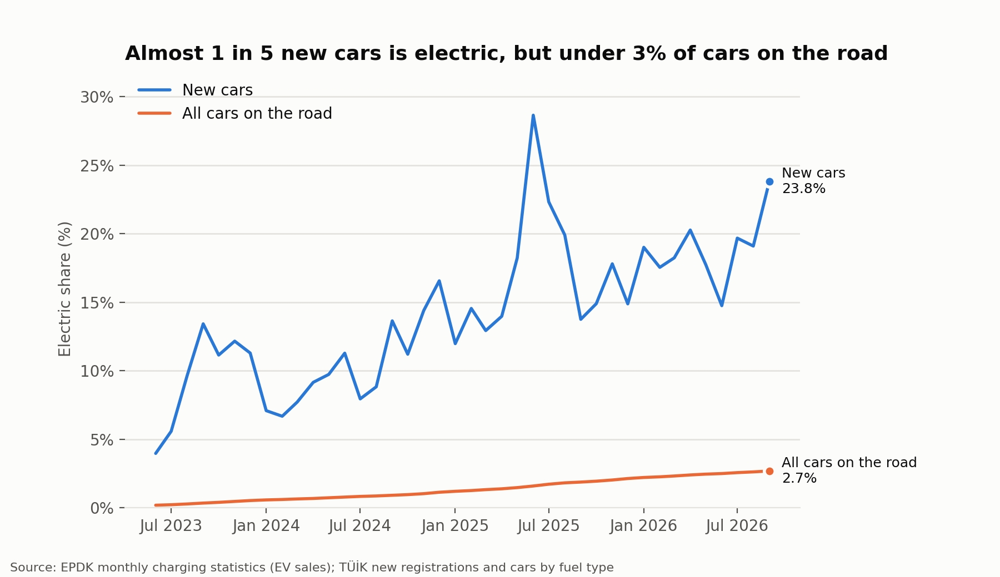
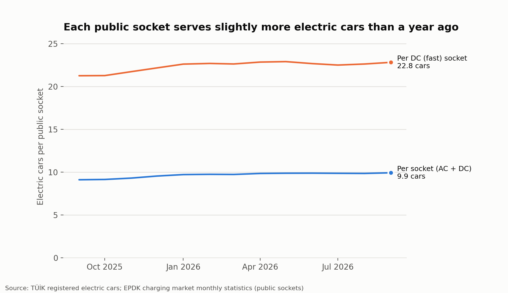
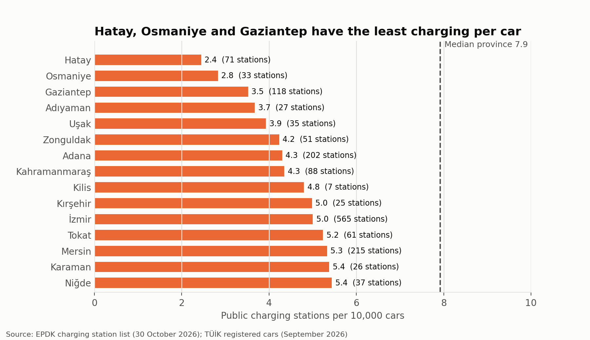
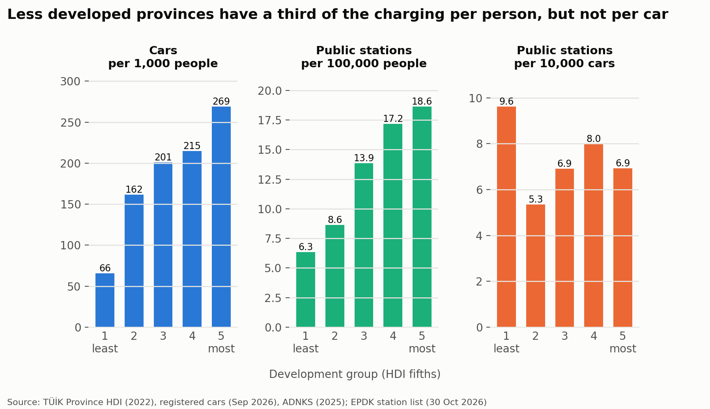
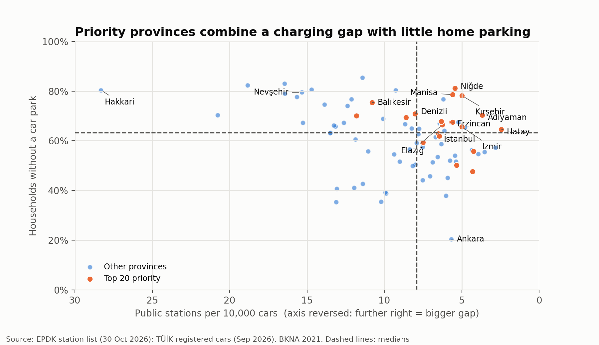
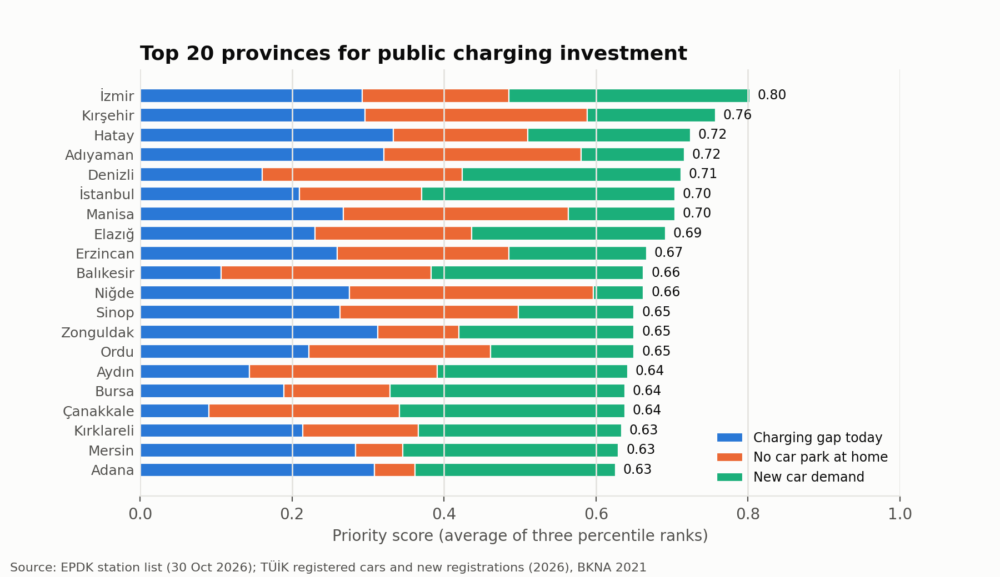

# Türkiye EV Adoption vs Charging Infrastructure

Is Türkiye's public charging network keeping pace with electric car adoption, and where should charging investment go next?

This project combines official open data on registered cars, charging stations, population, income, human development and housing for all 81 provinces of Türkiye. It answers four business questions and ends with a ranked list of priority provinces for investment. It is the Türkiye version of a [UK project](https://github.com/SSontay/uk-ev-charging-analysis) with the same questions and method.

## Summary

- **Sales are shifting fast, the fleet slowly.** Electric cars were 10.3% of new cars in 2024, 16.8% in 2025 and 18.9% in January–September 2026. They are still only 2.7% of cars on the road (486,359), but that number grew by 52% in the last year.
- **Public charging is growing, but not quite as fast.** Public sockets grew by 40% in a year, so each socket now serves 9.9 electric cars, up from 9.1. The ratio has been flat since February 2026.
- **The biggest gaps are in the south and in large cities.** Hatay, Osmaniye and Gaziantep have the fewest public stations per car. İzmir, Adana and Mersin have the largest gaps in absolute terms.
- **Charging has followed the cars.** Richer provinces have three times as many stations per person, but per car there is no link with income.
- **Recommendation:** prioritise **İzmir and Istanbul**, the **earthquake region** (Hatay, Adıyaman, Adana, Mersin) and **inland provinces with little home parking** (Kırşehir, Manisa, Niğde, Erzincan, Elazığ).

## Business questions and answers

### 1. How fast is Türkiye shifting to electric cars?



- The electric share of new cars rose from **10.3% (2024) to 16.8% (2025)** and **18.9% in January–September 2026** (23.8% in September 2026).
- The fleet changes much more slowly: electric cars are **2.7%** of registered cars, against 32% diesel, 31% petrol and 29% LPG. There are 45 times as many as four years ago.
- **Hybrids are growing faster in number:** in the last year the fleet gained 314,000 hybrids and 167,000 electric cars. Many buyers choose a car that needs no charger.

Notebook: [03_ev_adoption_speed](notebooks/03_ev_adoption_speed.ipynb)

### 2. Where are the biggest charging gaps?





- Nationally, electric cars grew by 52% and public sockets by 40% between September 2025 and September 2026. **Each socket serves 9.9 electric cars** (22.8 per DC fast socket).
- Türkiye has **7.0 public stations per 10,000 cars**. Batı Anadolu (5.7), Akdeniz (6.2), Batı Karadeniz (6.3) and Istanbul (6.5) are below that.
- **Hatay (2.4), Osmaniye (2.8) and Gaziantep (3.5)** have the least charging per car. Seven of the lowest nine provinces are in the area hit by the February 2023 earthquakes. All 15 lowest provinces are also below the median per person.
- Eastern provinces look well served per car only because they have very few cars.

Notebook: [04_charging_gap](notebooks/04_charging_gap.ipynb)

### 3. How does charging relate to income and development?



- **Future demand follows income.** Cars per 1,000 people rise from 66 in the least developed fifth of provinces to 269 in the most developed fifth (correlation with income 0.73).
- **Public charging per person follows income too** (6.3 against 18.6 stations per 100,000 people), but **per car the link disappears** (correlation −0.21): the network has gone where the cars are.
- Poorer provinces are not short of charging today, but will be as car ownership grows. Relative to its income, **Istanbul** has about 7 fewer stations per 100,000 people than expected. Tourism and motorway provinces (Nevşehir, Muğla, Bolu) have far more.

Notebook: [05_income_development](notebooks/05_income_development.ipynb)

### 4. Where should investment go?

A simple priority score for all 81 provinces. It is the average of three percentile ranks:

| Indicator | Reason to invest |
| --- | --- |
| Public stations per 10,000 cars (fewer = higher priority) | gap today |
| Households in buildings without a car park (BKNA 2021) | residents unlikely to charge at home |
| New cars per 1,000 people, January–September 2026 | where electric car demand is heading |





- The top five are **İzmir, Kırşehir, Hatay, Adıyaman and Denizli**, followed by Istanbul and Manisa.
- The list is spread over 11 of the 12 regions, with most in the Aegean, Marmara and Mediterranean regions. None are in Batı Anadolu: only 20% of households in Ankara live in a building without a car park.
- The ranking is robust to the weights used. When any one indicator counts double, 15 to 17 of the top 20 stay in the top 20.
- **Indicative size:** bringing the top 20 provinces to the median province would need about **1,600 extra public stations**, on top of the 5,800 they have today. İzmir (about 330) and Istanbul (about 590) account for more than half.

The full ranking is in [data/processed/province_priority_ranking.csv](data/processed/province_priority_ranking.csv). Notebook: [06_investment_priorities](notebooks/06_investment_priorities.ipynb)

## Recommendations

1. **Start with İzmir and Istanbul.** They combine a gap with the largest number of new car buyers. In Istanbul, where 63% of households have no car park, the need is mainly neighbourhood charging near homes.
2. **Build charging into the rebuilding of the earthquake region**, starting with Hatay and Adıyaman, and close the gaps in nearby Adana and Mersin. Kahramanmaraş and Osmaniye also have large gaps per car, but fewer new car buyers.
3. **Close the small gaps in inland provinces with little home parking** (Kırşehir, Manisa, Niğde, Erzincan, Elazığ). Each needs only 10–70 more stations.
4. **Watch Denizli, Balıkesir, Aydın and Çanakkale.** They have no gap today, but strong demand and little home parking.
5. **Lower priority:** Ankara (most households can charge at home), eastern provinces with few cars, and tourism and motorway provinces that already have many stations. Rapid charging on main roads is outside the scope of this analysis.

## Method notes and limitations

- **No electric car count by province.** TÜİK publishes cars by fuel type only for Türkiye as a whole. Province comparisons therefore use **public stations per car or per person**, which show readiness for future electric cars rather than service for today's. A request for province × fuel type data has been sent to TÜİK; if it arrives, questions 2 and 4 will be updated.
- **Stations, not sockets.** The EPDK station list has no socket count. Sockets (AC and DC) are only available nationally, from EPDK's monthly report, and are used only for the national trend.
- **How the station list was collected.** The EPDK page shows at most 500 rows per page and has no full export, so it was read page by page. Repeated passes returned 16,613 unique stations, against 17,113 records reported by the page. The difference is most likely duplicates in the page's count; at worst about 3% of stations are missing. 19 mobile charging vans and 5 stations with an unclear address are not assigned to a province.
- **Registration address.** Companies, public bodies and leasing firms register cars at their head office, which inflates car numbers in Istanbul and Ankara (and new car numbers even more).
- **Home parking** is taken from the Building and Dwelling Characteristics Survey 2021 and measures car parks in the building, not garages or the right to install a charger.
- **GDP per head** measures production, not household income, so industrial provinces such as Kocaeli look richer than their residents are.
- **Cross-check.** The national trend, regional ratios, development groups and top 20 priority provinces were recalculated in SQL and match the Python results ([notebook 07](notebooks/07_sql_checks.ipynb)).
- **Correlation is not causation.** The earthquake link and the tourism effect are likely explanations, not tested ones.

## Data sources

All data is official Turkish open data. Download links, dates and file details are in [data/raw/SOURCES.md](data/raw/SOURCES.md).

| Dataset | Publisher | Used for |
| --- | --- | --- |
| Road motor vehicles (by fuel type, by province, first registrations) | TÜİK | Registered and new cars, electric cars nationally |
| Address Based Population Registration System (ADNKS) | TÜİK | Population, density, urban share, household size by province |
| GDP by province; Province Human Development Index | TÜİK | Income and development by province |
| Building and Dwelling Characteristics Survey 2021 | TÜİK | Households without a car park in their building |
| Charging Service Market Monthly Statistics | EPDK | National EV count, sales and public sockets (AC/DC) |
| Charging station list | EPDK | Public and private charging stations by province |

## Project structure

```
data/raw/          original downloaded files (unchanged)
data/processed/    cleaned, analysis-ready tables and the priority ranking
sql/               SQL queries (DuckDB) that cross-check the key results
notebooks/         step-by-step analysis, 01 to 07
outputs/figures/   charts
```

| Notebook | Content |
| --- | --- |
| [01_data_exploration](notebooks/01_data_exploration.ipynb) | Structure and quirks of each raw file |
| [02_data_cleaning](notebooks/02_data_cleaning.ipynb) | Cleaning, joining keys and checks against Türkiye totals |
| [03_ev_adoption_speed](notebooks/03_ev_adoption_speed.ipynb) | Question 1 |
| [04_charging_gap](notebooks/04_charging_gap.ipynb) | Question 2 |
| [05_income_development](notebooks/05_income_development.ipynb) | Question 3 |
| [06_investment_priorities](notebooks/06_investment_priorities.ipynb) | Question 4 and recommendations |
| [07_sql_checks](notebooks/07_sql_checks.ipynb) | Key results of questions 2–4 recalculated in SQL and compared with the Python results |

## How to run

```bash
python -m venv .venv
.venv/bin/pip install -r requirements.txt
.venv/bin/jupyter lab
```

Run the notebooks in order. Notebook 02 creates the tables in `data/processed/` that the later notebooks use.

## Tools

- **Python** (pandas, matplotlib) in Jupyter notebooks for cleaning, analysis and charts.
- **SQL** (DuckDB, querying the clean CSV files directly) to recalculate the key results independently. The four queries in [sql/](sql) use CTEs and window functions (`NTILE`, `PERCENT_RANK`, `RANK`), and their results match the Python results.

The analysis was built with Claude Code as an AI assistant; I reviewed and interpreted every step, chart and conclusion.
